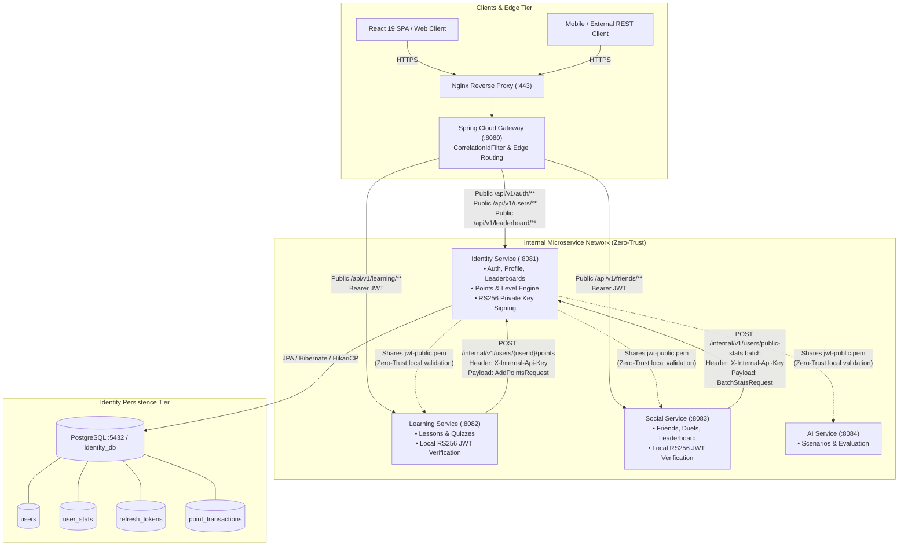
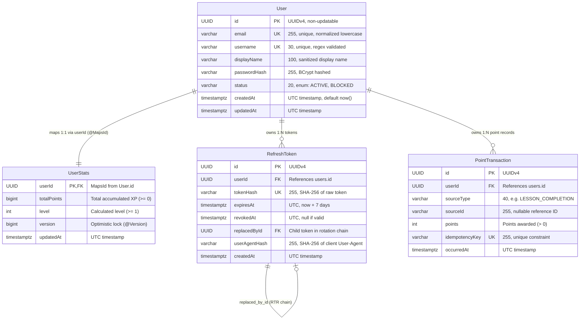
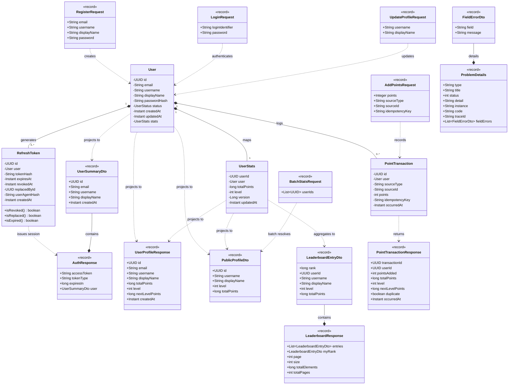
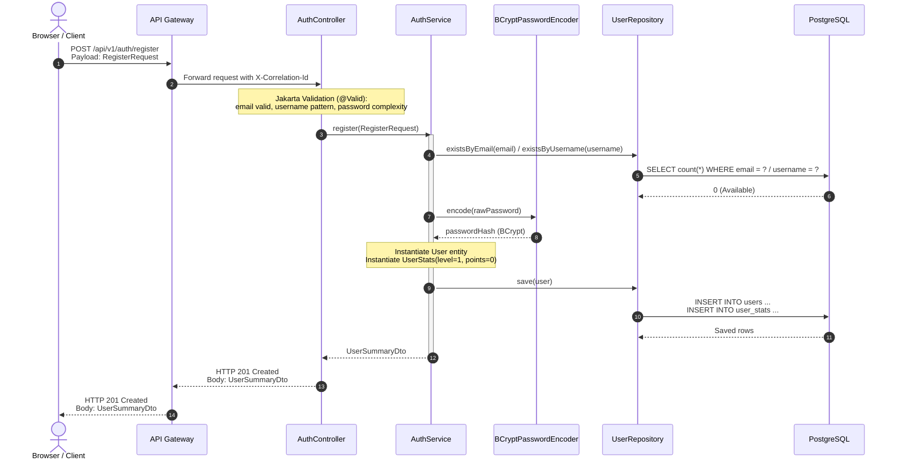
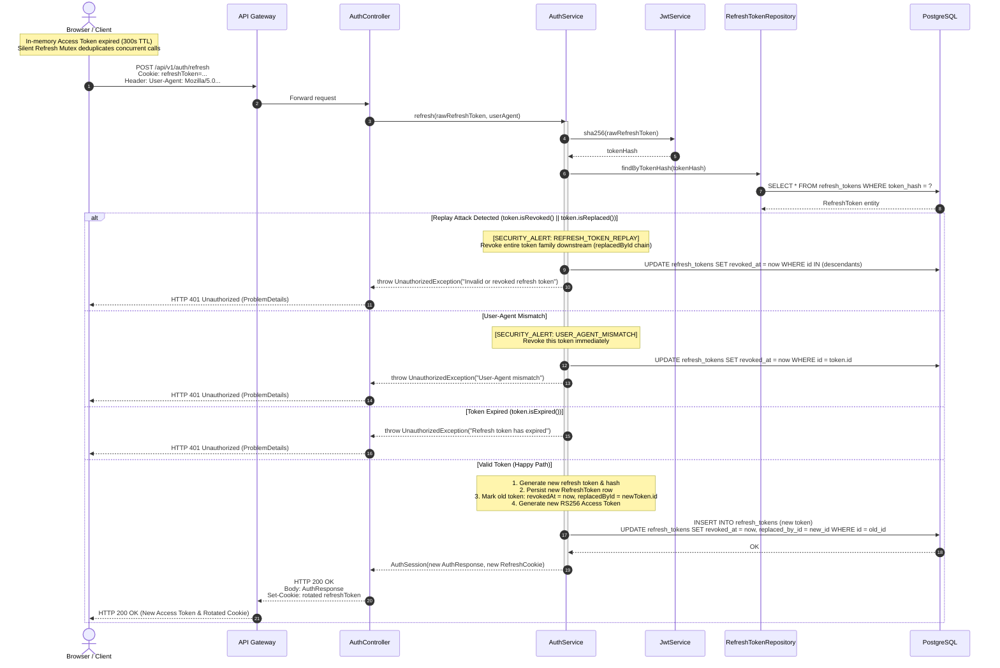
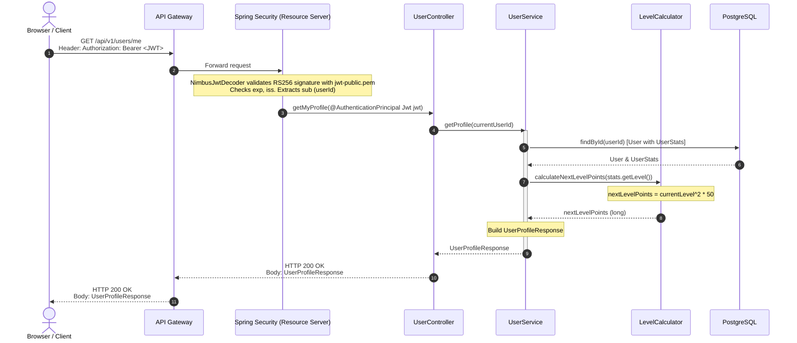
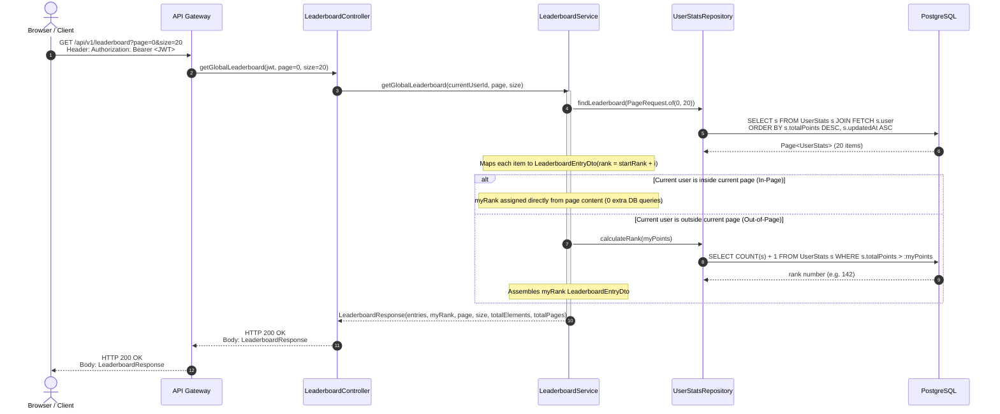
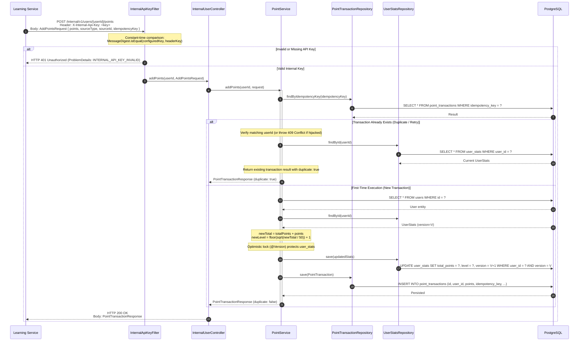
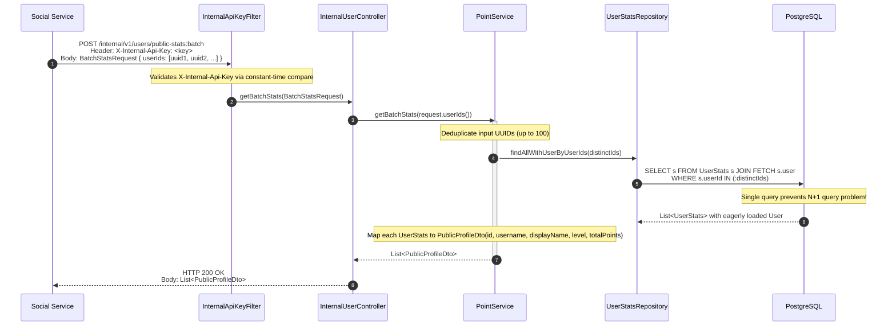
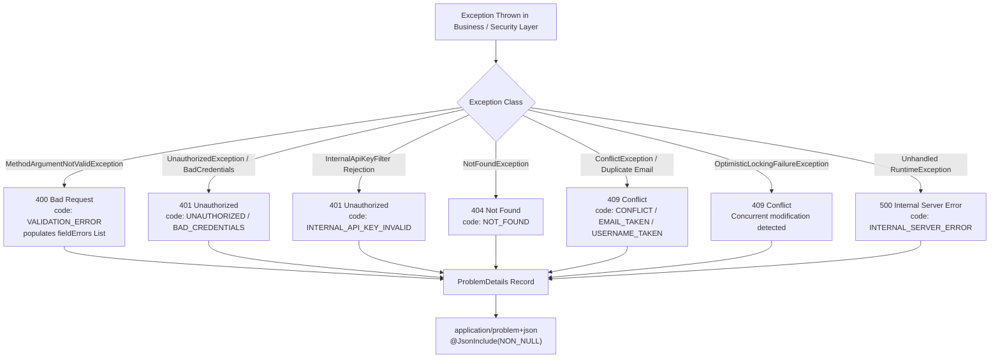

# Identity Service: Architecture, Request-Response Flows, JPAs & DTOs

This document presents a comprehensive architectural visualization and data flow specification for the **Identity Service (`hu.bme.szoftarch.identity`)**, its interactions with **Clients** (via the API Gateway) and **Other Internal Services** (such as Learning Service and Social Service), as well as the complete mapping of **JPA Entities** and **DTO Records**.

---

## 1. High-Level Architecture & Interaction Topology

The following diagram illustrates the boundary between public client access (routed through Nginx and Spring Cloud Gateway), internal microservice-to-microservice communication (using direct internal calls protected by shared secrets), and the Zero-Trust token validation mechanism.



---

## 2. JPA Domain Model & Entity-Relationship Diagram (ERD)

The Identity Service domain consists of 4 main JPA entities, mapped directly to PostgreSQL tables with strict constraints, indexes, and an optimistic locking mechanism.



### Key JPA Architectural Highlights:
1. **Primary Key Sharing (`@MapsId`):** `UserStats` shares its primary key `userId` with `User.id` via `@OneToOne` and `@MapsId`. This guarantees $1:1$ cardinality and optimal join performance.
2. **Optimistic Locking (`@Version`):** `UserStats.version` prevents the **Lost Update** problem when concurrent point awards happen simultaneously.
3. **Immutability & Token Hash Storage:** Raw refresh tokens are never persisted in the database; only their **SHA-256 digest** (`tokenHash`) is stored.
4. **Token Family Linking (`replacedById`):** In Refresh Token Rotation (RTR), each rotated token points to its successor, forming an auditable directed graph.

---

## 3. Class Diagram: DTOs & JPA Entities Decoupling

The DTO layer strictly decouples public API contracts from internal database representations, using Java records for immutability.



---

## 4. Sequence Diagrams: Detailed Communication Flows

### Flow 1: Client Registration (`POST /api/v1/auth/register`)



---

### Flow 2: Client Login & Session Issuance (`POST /api/v1/auth/login`)

```mermaid
sequenceDiagram
    autonumber
    actor Client as Browser / Client
    participant GW as API Gateway
    participant Ctrl as AuthController
    participant Svc as AuthService
    participant JwtSvc as JwtService
    participant DB as PostgreSQL

    Client->>GW: POST /api/v1/auth/login<br/>Header: User-Agent: Mozilla/5.0...<br/>Body: LoginRequest { loginIdentifier, password }
    GW->>Ctrl: Forward request
    Ctrl->>Svc: login(LoginRequest, userAgent)
    activate Svc
    Svc->>DB: findByEmailOrUsername(identifier)
    DB-->>Svc: User entity
    Svc->>Svc: BCrypt.matches(password, user.passwordHash)
    Note over Svc: Check user.status == ACTIVE
    Svc->>JwtSvc: generateAccessToken(user)
    Note over JwtSvc: Signs RS256 JWT with private key<br/>Claims: sub=userId, username, roles, exp=now+300s
    JwtSvc-->>Svc: accessToken string
    Svc->>JwtSvc: generateRefreshToken() & sha256(...)
    JwtSvc-->>Svc: rawRefreshToken, tokenHash, uaHash
    Note over Svc: Create RefreshToken entity (expiresAt = now + 7 days)
    Svc->>DB: INSERT INTO refresh_tokens (token_hash, user_agent_hash, ...)
    DB-->>Svc: Persisted
    Svc-->>Ctrl: AuthSession(AuthResponse, ResponseCookie)
    deactivate Svc
    Note over Ctrl: Sets Set-Cookie: refreshToken=...; HttpOnly; Secure; SameSite=Strict; Path=/api/v1/auth
    Ctrl-->>GW: HTTP 200 OK<br/>Body: AuthResponse<br/>Set-Cookie: refreshToken=...
    GW-->>Client: HTTP 200 OK<br/>Body: AuthResponse (stored in JS memory)<br/>Set-Cookie (stored in browser cookie jar)
```

---

### Flow 3: Silent Refresh with Rotation (RTR) & Replay Defense (`POST /api/v1/auth/refresh`)



---

### Flow 4: User Profile & Gamification Stats (`GET /api/v1/users/me`)



---

### Flow 5: Global Leaderboard & Individual Rank (`GET /api/v1/leaderboard`)



---

### Flow 6: Internal Learning Service Points Awarding (`POST /internal/v1/users/{userId}/points`)



---

### Flow 7: Internal Social Service Batch Stats Retrieval (`POST /internal/v1/users/public-stats:batch`)



---

### Flow 8: Zero-Trust Local JWT Validation in Internal Microservices

```mermaid
sequenceDiagram
    autonumber
    actor Client as Browser / Client
    participant GW as API Gateway
    participant InternalSvc as Learning / Social Service
    participant LocalSec as NimbusJwtDecoder (Local Resource Server)
    participant Ctrl as Service Controller
    participant KeyFile as Shared File: jwt-public.pem

    Client->>GW: GET /api/v1/lessons/active<br/>Header: Authorization: Bearer <JWT>
    Note over GW: Edge Gateway forwards Bearer Token intact.<br/>Does NOT strip or terminate authorization.
    GW->>InternalSvc: GET /api/v1/lessons/active<br/>Header: Authorization: Bearer <JWT>
    
    InternalSvc->>LocalSec: Filter incoming Bearer token
    Note over LocalSec: 1. Reads local jwt-public.pem<br/>2. Verifies RS256 signature mathematically (NO HTTP call to Identity!)<br/>3. Verifies issuer == 'szoftarch-nyelvtanulo'<br/>4. Verifies exp > now (300s TTL)<br/>5. Extracts sub (userId), username, roles
    
    alt Signature Invalid or Token Expired
        LocalSec-->>InternalSvc: Rejection
        InternalSvc-->>Client: HTTP 401 Unauthorized (RFC 9457 ProblemDetails)
    else Token Authenticated
        LocalSec->>Ctrl: Inject @AuthenticationPrincipal Jwt jwt into SecurityContext
        Note over Ctrl: UUID currentUserId = UUID.fromString(jwt.getSubject());<br/>Enforce IDOR check: currentUserId == lesson.ownerId
        Ctrl-->>Client: HTTP 200 OK (Domain Response)
    end
```

---

## 5. Comprehensive Request-Response & Data Mapping Matrix

| Category | HTTP Endpoint | Security & Headers / Cookies | Request Body DTO | Response Body DTO / Headers / Cookies | Involved JPA Entities | Key Invariants & Business Logic |
| :--- | :--- | :--- | :--- | :--- | :--- | :--- |
| **Auth** | `POST /api/v1/auth/register` | Public | [RegisterRequest](file:///home/istvan/szoftarch_projekt/services/identity-service/src/main/java/hu/bme/szoftarch/identity/api/dto/RegisterRequest.java)<br/>`email`, `username`, `displayName`, `password` | **201 Created**<br/>[UserSummaryDto](file:///home/istvan/szoftarch_projekt/services/identity-service/src/main/java/hu/bme/szoftarch/identity/api/dto/UserSummaryDto.java) | [User](file:///home/istvan/szoftarch_projekt/services/identity-service/src/main/java/hu/bme/szoftarch/identity/domain/User.java),<br/>[UserStats](file:///home/istvan/szoftarch_projekt/services/identity-service/src/main/java/hu/bme/szoftarch/identity/domain/UserStats.java) | BCrypt password hashing; normalized email/username uniqueness check; initializes stats (level=1, points=0). |
| **Auth** | `POST /api/v1/auth/login` | Public<br/>Header: `User-Agent` | [LoginRequest](file:///home/istvan/szoftarch_projekt/services/identity-service/src/main/java/hu/bme/szoftarch/identity/api/dto/LoginRequest.java)<br/>`loginIdentifier`, `password` | **200 OK**<br/>[AuthResponse](file:///home/istvan/szoftarch_projekt/services/identity-service/src/main/java/hu/bme/szoftarch/identity/api/dto/AuthResponse.java)<br/>`Set-Cookie: refreshToken=...; HttpOnly; SameSite=Strict; Path=/api/v1/auth; Max-Age=604800` | [User](file:///home/istvan/szoftarch_projekt/services/identity-service/src/main/java/hu/bme/szoftarch/identity/domain/User.java),<br/>[RefreshToken](file:///home/istvan/szoftarch_projekt/services/identity-service/src/main/java/hu/bme/szoftarch/identity/domain/RefreshToken.java) | Authenticates email/username; checks active status; issues 5-min RS256 access token; persists SHA-256 hashed refresh token with User-Agent hash. |
| **Auth** | `POST /api/v1/auth/refresh` | Cookie: `refreshToken`<br/>Header: `User-Agent` | *None* | **200 OK**<br/>[AuthResponse](file:///home/istvan/szoftarch_projekt/services/identity-service/src/main/java/hu/bme/szoftarch/identity/api/dto/AuthResponse.java)<br/>`Set-Cookie: refreshToken=...; HttpOnly; SameSite=Strict; ...` | [RefreshToken](file:///home/istvan/szoftarch_projekt/services/identity-service/src/main/java/hu/bme/szoftarch/identity/domain/RefreshToken.java),<br/>[User](file:///home/istvan/szoftarch_projekt/services/identity-service/src/main/java/hu/bme/szoftarch/identity/domain/User.java) | Refresh Token Rotation (RTR); Replay detection with downstream token family revocation; strict User-Agent hash verification. |
| **Auth** | `POST /api/v1/auth/logout` | Cookie: `refreshToken` | *None* | **204 No Content**<br/>`Set-Cookie: refreshToken=; Max-Age=0; Path=/api/v1/auth` | [RefreshToken](file:///home/istvan/szoftarch_projekt/services/identity-service/src/main/java/hu/bme/szoftarch/identity/domain/RefreshToken.java) | Marks DB refresh token `revokedAt = now`; clears client cookie immediately. |
| **Auth** | `POST /api/v1/auth/change-password` | Bearer JWT | [ChangePasswordRequest](file:///home/istvan/szoftarch_projekt/services/identity-service/src/main/java/hu/bme/szoftarch/identity/api/dto/ChangePasswordRequest.java)<br/>`currentPassword`, `newPassword` | **200 OK**<br/>[AuthResponse](file:///home/istvan/szoftarch_projekt/services/identity-service/src/main/java/hu/bme/szoftarch/identity/api/dto/AuthResponse.java)<br/>`Set-Cookie: refreshToken=...` | [User](file:///home/istvan/szoftarch_projekt/services/identity-service/src/main/java/hu/bme/szoftarch/identity/domain/User.java),<br/>[RefreshToken](file:///home/istvan/szoftarch_projekt/services/identity-service/src/main/java/hu/bme/szoftarch/identity/domain/RefreshToken.java) | Verifies current password; updates BCrypt hash; invokes `revokeAllForUser` to invalidate all active refresh tokens globally; issues fresh session for caller. |
| **Profile** | `GET /api/v1/users/me` | Bearer JWT | *None* | **200 OK**<br/>[UserProfileResponse](file:///home/istvan/szoftarch_projekt/services/identity-service/src/main/java/hu/bme/szoftarch/identity/api/dto/UserProfileResponse.java) | [User](file:///home/istvan/szoftarch_projekt/services/identity-service/src/main/java/hu/bme/szoftarch/identity/domain/User.java),<br/>[UserStats](file:///home/istvan/szoftarch_projekt/services/identity-service/src/main/java/hu/bme/szoftarch/identity/domain/UserStats.java) | Resolves user by JWT `sub`; computes `nextLevelPoints = level^2 * 50` in-memory. |
| **Profile** | `PATCH /api/v1/users/me` | Bearer JWT | [UpdateProfileRequest](file:///home/istvan/szoftarch_projekt/services/identity-service/src/main/java/hu/bme/szoftarch/identity/api/dto/UpdateProfileRequest.java)<br/>`username?`, `displayName?` | **200 OK**<br/>[UserProfileResponse](file:///home/istvan/szoftarch_projekt/services/identity-service/src/main/java/hu/bme/szoftarch/identity/api/dto/UserProfileResponse.java) | [User](file:///home/istvan/szoftarch_projekt/services/identity-service/src/main/java/hu/bme/szoftarch/identity/domain/User.java),<br/>[UserStats](file:///home/istvan/szoftarch_projekt/services/identity-service/src/main/java/hu/bme/szoftarch/identity/domain/UserStats.java) | Validates username uniqueness and format; updates display name; recalculates stats projection. |
| **Profile** | `GET /api/v1/users/search?username={q}` | Bearer JWT | Query param: `username` | **200 OK**<br/>`List<PublicProfileDto>` | [User](file:///home/istvan/szoftarch_projekt/services/identity-service/src/main/java/hu/bme/szoftarch/identity/domain/User.java),<br/>[UserStats](file:///home/istvan/szoftarch_projekt/services/identity-service/src/main/java/hu/bme/szoftarch/identity/domain/UserStats.java) | Prefix search on lower(username) using B-tree index; limits results to max 20 users. |
| **Profile** | `GET /api/v1/users/{id}/public` | Bearer JWT | Path param: `id` (UUID) | **200 OK**<br/>[PublicProfileDto](file:///home/istvan/szoftarch_projekt/services/identity-service/src/main/java/hu/bme/szoftarch/identity/api/dto/PublicProfileDto.java) | [User](file:///home/istvan/szoftarch_projekt/services/identity-service/src/main/java/hu/bme/szoftarch/identity/domain/User.java),<br/>[UserStats](file:///home/istvan/szoftarch_projekt/services/identity-service/src/main/java/hu/bme/szoftarch/identity/domain/UserStats.java) | Returns public gamified profile without sensitive fields (no email, no password hash). |
| **Leaderboard** | `GET /api/v1/leaderboard`<br/>`GET /api/v1/leaderboards/global` | Bearer JWT (optional/auth)<br/>Query: `page`, `size` | *None* | **200 OK**<br/>[LeaderboardResponse](file:///home/istvan/szoftarch_projekt/services/identity-service/src/main/java/hu/bme/szoftarch/identity/api/dto/LeaderboardResponse.java) | [UserStats](file:///home/istvan/szoftarch_projekt/services/identity-service/src/main/java/hu/bme/szoftarch/identity/domain/UserStats.java),<br/>[User](file:///home/istvan/szoftarch_projekt/services/identity-service/src/main/java/hu/bme/szoftarch/identity/domain/User.java) | Paginated query with `JOIN FETCH`; calculates `myRank` in-page (0 extra DB queries) or out-of-page via `COUNT(points > myPoints) + 1`. |
| **Leaderboard** | `GET /api/v1/leaderboard/me` | Bearer JWT | *None* | **200 OK**<br/>[LeaderboardEntryDto](file:///home/istvan/szoftarch_projekt/services/identity-service/src/main/java/hu/bme/szoftarch/identity/api/dto/LeaderboardEntryDto.java) | [UserStats](file:///home/istvan/szoftarch_projekt/services/identity-service/src/main/java/hu/bme/szoftarch/identity/domain/UserStats.java),<br/>[User](file:///home/istvan/szoftarch_projekt/services/identity-service/src/main/java/hu/bme/szoftarch/identity/domain/User.java) | Calculates individual rank and standing of the current user. |
| **Internal (Learning)** | `POST /internal/v1/users/{userId}/points` | Header: `X-Internal-Api-Key`<br/>Path: `userId` (UUID) | [AddPointsRequest](file:///home/istvan/szoftarch_projekt/services/identity-service/src/main/java/hu/bme/szoftarch/identity/api/dto/AddPointsRequest.java)<br/>`points`, `sourceType`, `sourceId`, `idempotencyKey` | **200 OK**<br/>[PointTransactionResponse](file:///home/istvan/szoftarch_projekt/services/identity-service/src/main/java/hu/bme/szoftarch/identity/api/dto/PointTransactionResponse.java) | [PointTransaction](file:///home/istvan/szoftarch_projekt/services/identity-service/src/main/java/hu/bme/szoftarch/identity/domain/PointTransaction.java),<br/>[UserStats](file:///home/istvan/szoftarch_projekt/services/identity-service/src/main/java/hu/bme/szoftarch/identity/domain/UserStats.java) (with `@Version`),<br/>[User](file:///home/istvan/szoftarch_projekt/services/identity-service/src/main/java/hu/bme/szoftarch/identity/domain/User.java) | Guaranteed idempotency via unique `idempotency_key` constraint; duplicate calls return original result with `duplicate: true`; optimistic lock protects `UserStats`. |
| **Internal (Social)** | `POST /internal/v1/users/public-stats:batch` | Header: `X-Internal-Api-Key` | [BatchStatsRequest](file:///home/istvan/szoftarch_projekt/services/identity-service/src/main/java/hu/bme/szoftarch/identity/api/dto/BatchStatsRequest.java)<br/>`userIds: List<UUID>` (max 100) | **200 OK**<br/>`List<PublicProfileDto>` | [UserStats](file:///home/istvan/szoftarch_projekt/services/identity-service/src/main/java/hu/bme/szoftarch/identity/domain/UserStats.java),<br/>[User](file:///home/istvan/szoftarch_projekt/services/identity-service/src/main/java/hu/bme/szoftarch/identity/domain/User.java) | Batch fetch of user stats using single `JOIN FETCH` query; eliminates $N+1$ performance issue. |
| **Error (All)** | *Any failing endpoint* | N/A | N/A | **400 / 401 / 404 / 409 / 500**<br/>`Content-Type: application/problem+json`<br/>[ProblemDetails](file:///home/istvan/szoftarch_projekt/services/identity-service/src/main/java/hu/bme/szoftarch/identity/api/dto/ProblemDetails.java) | N/A | RFC 9457 compliant error structure with error `code`, HTTP status, trace/correlation ID, and detailed validation `fieldErrors`. |

---

## 6. Detailed DTO vs JPA Data Mapping Specification

### 6.1. Why Complete Decoupling is Crucial
1. **Mass-Assignment (Over-Posting) Prevention:**
   If the controllers accepted `User` directly, a malicious client could craft a JSON payload containing `"status": "BLOCKED"` or tamper with `"version"` or `"id"`. By accepting only `RegisterRequest` or `UpdateProfileRequest`, the API boundary enforces that only permitted fields can enter the system.
2. **Data Leakage Prevention:**
   `User` contains sensitive fields (`passwordHash`). Returning the entity directly would risk serialization bugs exposing hashes. Using `UserSummaryDto`, `UserProfileResponse`, and `PublicProfileDto` guarantees that credentials never reach the network.
3. **Database Schema Evolution:**
   Tables can be partitioned, columns renamed, or indexes restructured without breaking the contract specified in [identity-api.yaml](file:///home/istvan/szoftarch_projekt/contracts/openapi/identity-api.yaml).

### 6.2. Field-by-Field Mapping Reference

#### `User` Entity $\longleftrightarrow$ DTOs
```
User Entity                          DTO Field                              Purpose
====================================================================================================
id (UUID)                        --> UserSummaryDto.id                      Identity anchor
                                 --> UserProfileResponse.id                 Profile identifier
                                 --> PublicProfileDto.id                    Public ID for Social
email (String)                   <-- RegisterRequest.email                  Registration input
                                 --> UserSummaryDto.email                   Summary output
                                 --> UserProfileResponse.email              Private profile output
username (String)                <-- RegisterRequest.username               Registration input
                                 <-- UpdateProfileRequest.username          Profile update input
                                 --> UserSummaryDto.username                Summary output
                                 --> UserProfileResponse.username           Private profile output
                                 --> PublicProfileDto.username              Public search/social
                                 --> LeaderboardEntryDto.username           Leaderboard row
displayName (String)             <-- RegisterRequest.displayName            Registration input
                                 <-- UpdateProfileRequest.displayName       Profile update input
                                 --> UserSummaryDto.displayName             Summary output
                                 --> UserProfileResponse.displayName        Private profile output
                                 --> PublicProfileDto.displayName           Public profile
                                 --> LeaderboardEntryDto.displayName        Leaderboard row
passwordHash (String)            <-- BCrypt(RegisterRequest.password)       Hashed before save; NEVER exposed in DTOs
status (UserStatus)              (internal only)                            Active check; suspended users blocked
createdAt (Instant)              --> UserSummaryDto.createdAt               Registration timestamp
                                 --> UserProfileResponse.createdAt          Profile creation timestamp
```

#### `UserStats` Entity $\longleftrightarrow$ DTOs & Engine
```
UserStats Entity                     DTO / Calculated Field                 Purpose
====================================================================================================
totalPoints (long)               --> UserProfileResponse.totalPoints        Total XP for user profile
                                 --> PublicProfileDto.totalPoints           Total XP for public/social
                                 --> LeaderboardEntryDto.totalPoints        XP displayed in leaderboard
                                 --> PointTransactionResponse.totalPoints   Post-transaction XP
level (int)                      --> UserProfileResponse.level              Current level
                                 --> PublicProfileDto.level                 Public level
                                 --> LeaderboardEntryDto.level              Level in leaderboard
                                 --> PointTransactionResponse.level         Post-transaction level
[LevelCalculator]                --> UserProfileResponse.nextLevelPoints    level^2 * 50
                                 --> PointTransactionResponse.nextLevelPoints
version (Long)                   (internal @Version)                        Optimistic locking (Lost Update protection)
```

#### `PointTransaction` Entity $\longleftrightarrow$ DTOs
```
PointTransaction Entity              DTO Field                              Purpose
====================================================================================================
id (UUID)                        --> PointTransactionResponse.transactionId Identifier of transaction
points (int)                     <-- AddPointsRequest.points                Points awarded from lesson
                                 --> PointTransactionResponse.pointsAdded   Echoed in response
sourceType (String)              <-- AddPointsRequest.sourceType            Domain event source (e.g. LESSON)
sourceId (String)                <-- AddPointsRequest.sourceId              Lesson or quiz ID
idempotencyKey (String)          <-- AddPointsRequest.idempotencyKey        Unique constraint; retry guard
occurredAt (Instant)             --> PointTransactionResponse.occurredAt    Transaction timestamp
```

#### `RefreshToken` Entity $\longleftrightarrow$ HTTP Cookies
```
RefreshToken Entity                  Transport Mechanism                    Security Details
====================================================================================================
tokenHash (String)               <-- SHA256(rawRefreshToken)                Raw token sent in HttpOnly cookie
expiresAt (Instant)              <-- now + 604800s                          Enforced on refresh
revokedAt (Instant)              (internal DB state)                        Populated on logout or rotation
replacedById (UUID)              (internal DB state)                        Points to next token in RTR chain
userAgentHash (String)           <-- SHA256(HttpServletRequest.User-Agent)  Strict rejection on platform change
```

---

## 7. Error Handling & RFC 9457 Problem Details Mapping

All controller exceptions are mapped through [GlobalExceptionHandler](file:///home/istvan/szoftarch_projekt/services/identity-service/src/main/java/hu/bme/szoftarch/identity/api/GlobalExceptionHandler.java) and [SecurityConfig](file:///home/istvan/szoftarch_projekt/services/identity-service/src/main/java/hu/bme/szoftarch/identity/infrastructure/SecurityConfig.java) into standard RFC 9457 `application/problem+json` responses:


