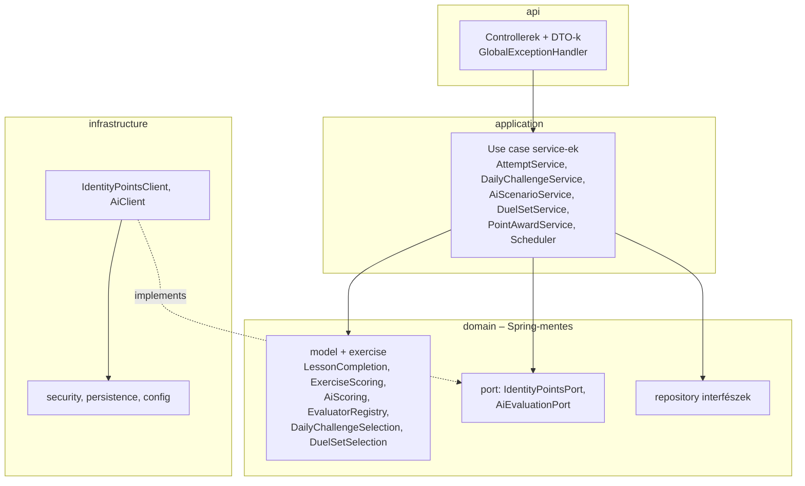
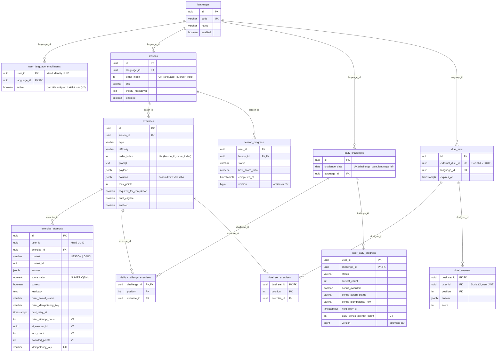
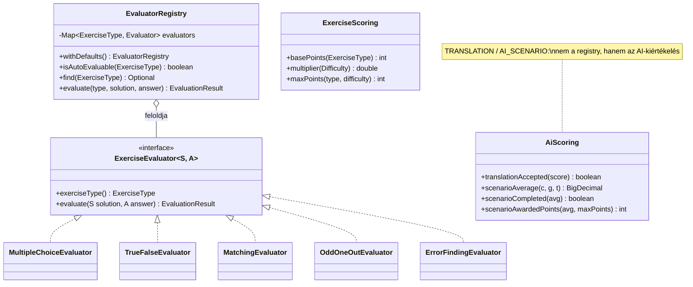
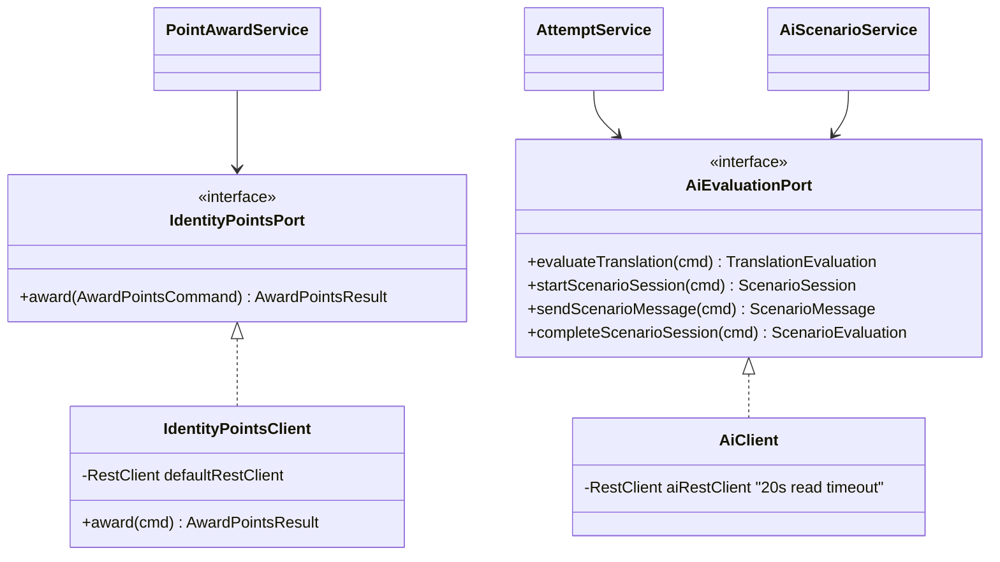
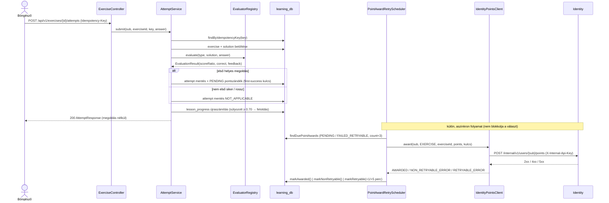
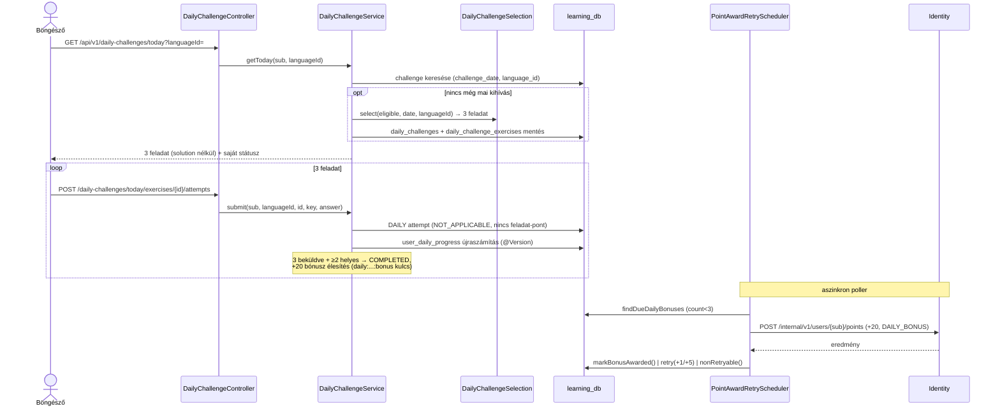

# Rendszerterv – Learning Service (B csomag)

> Ez a fejezet a `services/learning-service` már megírt és review-approved
> állapotát (U0–U10) dokumentálja. A megállapítások a tényleges forráskódra
> hivatkoznak (osztály-, fájl-, endpoint- és migrációnevek), a számok a kódban
> szereplő értékek. A merge-nél ez a fájl a közös `docs/rendszerterv.md` Learning
> szekciójába illesztendő be.
>
> **A TERV baseline-tól való tudatos eltérés (lásd 4. szakasz):** a
> pontjóváírás retry-időzítése a kódban **0 / +1 / +5 perc** (3 küldés), NEM a
> TERV 7.8 „1/5/15 perc". Az alábbi leírás a TÉNYLEGES viselkedést rögzíti.

## 1. Felelősség és belső rétegek

A Learning Service felelőssége: nyelvek és beiratkozások kezelése, leckék és
elméleti anyag kiszolgálása, feladatok prezentációja (megoldás nélkül),
feladatbeküldés kiértékelése, leckehaladás és feloldás, napi kihívás, a
mondatfordítás és AI-szituáció orkesztrációja az AI service felé, a profilpont
jóváírásának kezdeményezése az Identity felé, és a párbaj-feladatkészlet
kiszolgálása a Social felé. Saját adatbázisa a `learning_db`.

A service klasszikus háromrétegűségű, a csomagszerkezet a
`hu.bme.szoftarch.learning` gyökér alatt négy réteg:

- **api** – controllerek, request/response DTO-k, globális hibakezelő.
  Belépési pont a HTTP felől. Pl. `ExerciseController`, `DailyChallengeController`,
  `AiScenarioController`, `DuelSetController`, `GlobalExceptionHandler`.
- **application** – use case service-ek, tranzakcióhatárok, orkesztráció. Pl.
  `AttemptService`, `AiScenarioService`, `DailyChallengeService`, `DuelSetService`,
  `PointAwardService`, `PointAwardRetryScheduler`.
- **domain** – entitások és enumok (`domain.model`), a feladat payload/solution
  recordok és a kiértékelő Strategy réteg (`domain.exercise`), a kimenő portok
  (`domain.port`), repository-interfészek (`domain.repository`), és a
  Spring-mentes üzleti segédek (`domain.progress.LessonCompletion`,
  `domain.daily.DailyChallengeSelection`, `domain.daily.BusinessClock`,
  `domain.duel.DuelSetSelection`).
- **infrastructure** – a kimenő portok konkrét adapterei (`infrastructure.client`:
  `IdentityPointsClient`, `AiClient`), biztonsági konfiguráció
  (`infrastructure.security`), JSONB-perzisztencia (`infrastructure.persistence`),
  és egyéb konfiguráció (`infrastructure.config`).

**Függési irány:** `api → application → domain ← infrastructure`. A domain nem
függ a Springtől. A kimenő függőségeket (Identity, AI) a domain `port`
interfészekkel írja le (`IdentityPointsPort`, `AiEvaluationPort`), az
implementációjuk az infrastructure rétegben van — a függés így befelé, a domain
felé mutat (függőséginverzió). A domain üzleti magja (`LessonCompletion`,
`ExerciseScoring`, `AiScoring`, `EvaluatorRegistry`, `DailyChallengeSelection`,
`DuelSetSelection`) tiszta Java, Spring-annotáció nélkül, önmagában
unit-tesztelhető.



## 2. Adatmodell (learning_db) és adatownership

A séma a `V1__baseline.sql` baseline-ból és a `V2`–`V6` additív migrációkból áll
(`src/main/resources/db/migration/`):

- `V1__baseline.sql` – alaptáblák: `languages`, `user_language_enrollments`,
  `lessons`, `exercises`, `exercise_attempts`, `lesson_progress`,
  `daily_challenges`, `daily_challenge_exercises`, `user_daily_progress`,
  `duel_sets`, `duel_set_exercises`, `duel_answers`. A `duel_*` táblák már itt
  vannak, U7-hez nem kellett új migráció.
- `V2__active_enrollment_unique.sql` – `uq_active_enrollment_per_user` parciális
  unique index (`WHERE active`): felhasználónként legfeljebb egy aktív beiratkozás.
- `V3__point_attempt_count.sql` – `exercise_attempts.point_attempt_count INT NOT NULL DEFAULT 0`
  (a pont-retry számlálója).
- `V4__daily_bonus_attempt_count.sql` – `user_daily_progress.daily_bonus_attempt_count INT NOT NULL DEFAULT 0`
  (a napi bónusz retry számlálója).
- `V5__ai_attempt_link.sql` – az `exercise_attempts`-hez `ai_session_id UUID`,
  `turn_count INT NOT NULL DEFAULT 0`, `awarded_points INT`, és `idx_attempts_ai_session`.
- `V6__seed.sql` – tananyag seed: 1 nyelv (angol), 4 sorrendi lecke, 28 feladat
  (leckénként 5 auto + 2 AI), 15 duel-eligible auto feladat. Fix UUID-k,
  idempotens, nincs felhasználói adat.

**Adatownership:** más domain entitására (pl. a felhasználóra) csak UUID
hivatkozás van, idegen kulcs nélkül, nincs cross-DB join. A
`user_language_enrollments.user_id`, `exercise_attempts.user_id`,
`lesson_progress.user_id`, `user_daily_progress.user_id`, `duel_answers.user_id`
mind külső (Identity) azonosítók idegen kulcs nélkül; a
`duel_sets.external_duel_id` a Social párbaj UUID-ja. A JWT-ből kinyert `sub` a
forrás minden felhasználói műveletnél (`CurrentUser`), soha nem request body.



Minden időbélyeg UTC-ben tárolódik (`TIMESTAMPTZ`); a napi kihívás üzleti napja
`Europe/Budapest` (lásd `BusinessClock`).

## 3. Feladatkiértékelési Strategy minta (U3)

A kiértékelés Strategy minta szerint épül (`domain.exercise`). Az
`ExerciseEvaluator<S, A>` interfész egy feladattípus egzakt kiértékelését írja
le: a megbízható `ExerciseSolution` recordot és a felhasználó deszerializált
`UserAnswer`-jét kapja, és `EvaluationResult`-ot ad (`scoreRatio`, `correct`,
megoldást nem szivárogtató `feedback`). Öt automatikus implementáció van:
`MultipleChoiceEvaluator`, `TrueFalseEvaluator`, `MatchingEvaluator`,
`OddOneOutEvaluator`, `ErrorFindingEvaluator`.

Az `EvaluatorRegistry` a típus → stratégia feloldást végzi (`EnumMap`,
`withDefaults()` tölti fel az öt auto evaluatort). A `TRANSLATION` és
`AI_SCENARIO` NEM auto-kiértékelésű: a registry `find()`-je üres `Optional`-t,
az `evaluate()` kezelt `NotAutoEvaluableException`-t ad (a `GlobalExceptionHandler`
ezt 400-zá fordítja `exercise_not_auto_evaluable` kóddal), nem nyers kivételt.
Ezt a két típust az U8 AI-kiértékelése kezeli (lásd 4. szakasz).

**Pontszámítás** (`ExerciseScoring`, Spring-mentes): alappont típusonként
(`MULTIPLE_CHOICE` 10, `TRUE_FALSE` 8, `MATCHING` 12, `ODD_ONE_OUT` 10,
`ERROR_FINDING` 12), nehézségi szorzó `EASY` 1.0 / `MEDIUM` 1.5 / `HARD` 2.0, és
`maxPoints = floor(alappont × szorzó)`. Az AI-típusokra a `basePoints`/`maxPoints`
`NotAutoEvaluableException`-t dob; az AI-pontot az `AiScoring` kezeli.



## 4. Adapter minta: AI és Identity portok (U8, U5)

**AI Adapter (U8).** A domain `AiEvaluationPort` írja le a kimenő AI-műveleteket
(`evaluateTranslation`, `startScenarioSession`, `sendScenarioMessage`,
`completeScenarioSession`); a konkrét adapter az `infrastructure.client.AiClient`,
amely a `aiRestClient` beanen (connect 2s / **read 20s**, `RestClientConfig`)
négy belső AI-végpontot hív `X-Internal-Api-Key` headerrel:
`POST /internal/v1/translations:evaluate`, `POST /internal/v1/scenario-sessions`,
`.../{id}/messages`, `.../{id}/complete`. Hibakezelés: 5xx, connect/read timeout,
hálózati hiba vagy hiányzó/hibás body egységesen `AiEvaluationException`, amit a
`GlobalExceptionHandler` **502 `ai_unavailable`** problem+json-ná fordít. Ilyenkor
a hívó tranzakció visszagördül, **nincs pontlevonás** és nem íródik pontszándék;
a kliens újrapróbálhat.

**Orkesztráció elve:** az eredmény és a pont szerveroldalon dől el, a böngésző
nem hamisíthat. A fordításnál (`AttemptService.evaluateTranslation`) a kliens
bemenetéből kizárólag a felhasználó fordításszövegét (`text` mező) veszi át, a
feladat-konfig (`sourceText`, `targetLanguageCode`, `rubric`) a megbízható
payloadból jön. Az AI-szituációnál minden üzenet a publikus learning API-n megy
át (`AiScenarioService`), a felhasználói szöveg adatként jut a modellhez. Az
elfogadás/pont az `AiScoring`-ban dől el: fordítás elfogadva, ha
`score >= 0.70` (`TRANSLATION_ACCEPT_THRESHOLD`); szituáció teljesítve, ha a
három részpont átlaga `>= 0.60` (`SCENARIO_COMPLETE_THRESHOLD`); szituáció pontja
`round(átlag × maxPoints)`, legfeljebb 30 (`SCENARIO_MAX_AWARDED_POINTS`). A
learning csak a saját attemptet és egy `ai_session_id` hivatkozást tárol (V5), az
üzenettartalmat soha (az az ai_db-é).

**Identity pont-Adapter (U5).** A domain `IdentityPointsPort` írja le a
pontjóváírást; a konkrét adapter az `infrastructure.client.IdentityPointsClient`,
amely a `defaultRestClient` beanen (connect 2s / read 5s)
`POST {IDENTITY_URL}/internal/v1/users/{userId}/points` hívást küld
`X-Internal-Api-Key` headerrel és `{sourceType, sourceId, points, idempotencyKey}`
body-val. Kimenet-leképezés: 2xx → `AWARDED`; 4xx → `NON_RETRYABLE_ERROR`;
5xx / timeout / hálózati hiba → `RETRYABLE_ERROR`.

**Idempotenciakulcs** (determinisztikus, `AttemptService`/`AiScenarioService`/
`DailyChallengeService`): normál lecke első siker
`exercise:{userId}:{exerciseId}:first-success`; napi bónusz
`daily:{userId}:{yyyy-MM-dd}:bonus` (a dátum a budapesti üzleti nap). Ugyanaz a
kulcs ismételve nem ad dupla pontot.

**Retry — TÉNYLEGES viselkedés (0 / +1 / +5 perc, max 3):** a `PointAwardService`
`RETRY_DELAYS = {1 perc, 5 perc, 15 perc}` tömböt definiál, és a `next_retry_at`
az addigi próbálkozás-szám alapján számolódik. A `PointAwardRetryScheduler` a
`PENDING` sort azonnal (`next_retry_at` nélkül, 0 perc) felveszi; az első hiba
után `+1 perc`, a második után `+5 perc`. A poller lekérdezése csak a
`point_attempt_count < 3` (illetve `daily_bonus_attempt_count < 3`) sorokat veszi
fel, ezért a 3. küldés a 2. hiba után `+5 perccel` esedékes, és a `+15 perces`
slot soha nem sül el. A tényleges időzítés tehát **0 / +1 / +5 perc (3 küldés)**.

> **Eltérés a TERV baseline-tól (INTEGRACIO 4.1).** A TERV 7.8 „1/5/15 perc"-et
> ír; a 3-as próbálkozás-sapka miatt a megvalósítás ténylegesen 0 / +1 / +5 perc.
> A dokumentáció szándékosan a kód szerinti viselkedést rögzíti; nem funkcionális
> hiba, a retry-számláló (`V3`/`V4`) garantálja a véges próbálkozást.

A nem újrapróbálható (4xx) hiba a sort `FAILED_RETRYABLE`-re állítja
`next_retry_at = null`-lal (`ExerciseAttempt.markNonRetryable`), így a poller
többé nem választja ki. A pontküldés aszinkron (poller), nem blokkolja a
felhasználói választ.



## 5. Kritikus szekvenciadiagramok

### 5.1 Normál automatikus feladat: beküldés → kiértékelés → progress → pontjóváírás



### 5.2 AI-szituáció (scenario) session: start → messages → complete → értékelés + pont

```mermaid
sequenceDiagram
    actor U as Böngésző
    participant SC as AiScenarioController
    participant SS as AiScenarioService
    participant AI as AiClient → AI service
    participant DB as learning_db

    U->>SC: POST /api/v1/ai-scenarios/{exerciseId}/sessions (Idempotency-Key)
    SC->>SS: startSession(sub, exerciseId, key)
    SS->>AI: startScenarioSession(role, situation, goals, lang, opening)
    AI-->>SS: ScenarioSession(aiSessionId, openingMessage)
    SS->>DB: LESSON attempt + assignAiSession(aiSessionId, 0)
    SS-->>U: aiSessionId + attemptId + opening

    loop 1..8 forduló
        U->>SC: POST /ai-scenarios/sessions/{sessionId}/messages
        SC->>SS: sendMessage(sub, sessionId, message)
        SS->>AI: sendScenarioMessage(sessionId, userMessage)
        AI-->>SS: aiMessage + turnCount
        SS->>DB: turnCount frissítés
        SS-->>U: aiMessage + turnCount
    end

    U->>SC: POST /ai-scenarios/sessions/{sessionId}/complete
    SC->>SS: complete(sub, sessionId, key)
    Note over SS: min. 3 forduló kell; 8-nál auto-complete
    SS->>AI: completeScenarioSession(sessionId)
    AI-->>SS: comprehensibility, grammar, taskCompletion, feedback
    Note over SS: avg = (c+g+t)/3 ; completed = avg ≥ 0.60 ;<br/>points = round(avg × maxPoints), max 30
    SS->>DB: applyScenarioResult + (first-success) PENDING pontszándék
    SS-->>U: ScenarioCompleteResponse (avg, completed, points, feedback)
```

### 5.3 Napi kihívás teljesítés + egyszeri +20 bónusz



## 6. Üzleti szabályok összefoglalója (tényleges konstansokkal)

- **Lecke-feloldás 70%** (`LessonCompletion.COMPLETION_THRESHOLD = 0.70`): a lecke
  akkor `COMPLETED`, ha minden `required_for_completion` feladatot megpróbáltak,
  és a kötelezők `max_points`-tal súlyozott legjobb pontarányainak átlaga
  `≥ 0.70`. Az AI-feladatok opcionálisak, kimaradnak a számlálóból és a nevezőből.
  Az első lecke mindig nyitva; a többi, ha az előző `COMPLETED`.
- **Napi kihívás** (`DailyChallengeSelection.CHALLENGE_SIZE = 3`): 3
  duel-eligible, auto feladat, determinisztikusan a `date + ":" + languageId`
  seedből; `≥ 2` helyes a teljesítéshez; egyszeri **+20** bónusz
  (`PointAwardService.DAILY_BONUS_POINTS = 20`); a napváltás `Europe/Budapest`
  (`BusinessClock`). A DAILY attempt NEM ad feladatpontot, a napi kihívás egyetlen
  pont-forrása a +20 bónusz.
- **Párbaj duel-set** (`DuelSetSelection.DUEL_SET_SIZE = 5`): fix 5 feladatos,
  mentett készlet, mindkét fél ugyanazt kapja; helyes válasz → `max_points`,
  hibás → 0; **nincs profilpont** (soha nincs Identity-hívás a párbajból).
- **Feladattípus-alappontok és szorzók** (`ExerciseScoring`): alappont MC 10 /
  TF 8 / MATCHING 12 / ODD_ONE_OUT 10 / ERROR_FINDING 12; szorzó EASY 1.0 /
  MEDIUM 1.5 / HARD 2.0; `maxPoints = floor(alappont × szorzó)`.
- **AI-küszöbök** (`AiScoring`): fordítás elfogadva `score ≥ 0.70`; szituáció
  teljesítve átlag `≥ 0.60`; szituáció pont `round(átlag × maxPoints)`, max 30.
- **Idempotencia:** minden beküldés `Idempotency-Key`-t vár (unique
  `exercise_attempts.idempotency_key`); a pont-kulcsok determinisztikusak
  (first-success és daily bonus), ugyanaz a kulcs nem ad dupla pontot.

## 7. Konkurencia, idempotencia és hibakezelés

- **Optimista zár** (`@Version` / `version BIGINT`): a `lesson_progress` és a
  `user_daily_progress` soron; konkurens frissítésnél
  `ObjectOptimisticLockingFailureException` → 409 `progress_conflict`. A párbaj
  egyedisége a `duel_answers` összetett kulcsával (`duel_set_id, user_id, position`)
  biztosított.
- **Unique constraintek:** `exercise_attempts.idempotency_key` (dupla beküldés),
  `uq_active_enrollment_per_user` parciális index (user-enkénti egy aktív nyelv,
  verseny → 409), `daily_challenges (challenge_date, language_id)` (lazy
  létrehozás versenye), `duel_sets.external_duel_id` (idempotens duel-set).
  Egyidejű azonos kulcsnál a vesztő tranzakció visszagördül, és a nyertes által
  commitolt sort egy `REQUIRES_NEW` olvasó tranzakció adja vissza — nem 500.
- **Hibaformátum:** RFC 9457 `application/problem+json` a
  `GlobalExceptionHandler`-ből; minden válaszban `type`, `title`, `status`,
  `detail`, `instance`, `code`, `traceId`, validációnál `fieldErrors`. Jellemző
  kódok: `exercise_not_found` (404), `answer_type_mismatch` /
  `exercise_not_auto_evaluable` / `validation_error` (400), `progress_conflict`
  (409), `ai_unavailable` (502). Titok, token és helyes megoldás soha nem kerül a
  válaszba vagy a logba.

## 8. Frontend (learning + daily feature)

A frontend `features/learning/` és `features/daily/` mappáiban van, a közös
skeletonra (MUI theme, `api/client.ts`, MSW) épülve, TanStack Query + React Hook
Form + Zod használatával.

- **Oldalak:** `LanguagesPage` (nyelvválasztás/aktiválás), `LessonListPage`
  (leckelista + állapotok), `LessonDetailPage` (elmélet + feladat-metaadat),
  `ExercisePlayerPage`/`ExercisePlayer` (mind az 5 auto típus külön input-
  komponenssel: `MultipleChoiceExercise`, `TrueFalseExercise`, `MatchingExercise`,
  `OddOneOutExercise`, `ErrorFindingExercise`, plus `TranslationExercise`),
  `ScenarioChatPage` (AI-beszélgetés), és a `features/daily/DailyChallengePage`
  (napi kihívás). Az API-hívások egy-egy függvényként: `features/learning/api.ts`.
- **A solution sosem jelenik meg:** az `ExercisePlayer` sem meg nem jeleníti, sem
  le nem vezeti a helyes választ; a backend prezentáció is solution nélküli.
- **Állapotkezelés:** TanStack Query a szerverállapotra (loading/empty/error
  állapotok), React Hook Form + Zod a beküldés validációjára; minden mutáló
  hívás `Idempotency-Key`-t küld (`newIdempotencyKey`). A `PointAwardStatus`
  felhasználóbarát címkékre képződik (`NOT_APPLICABLE`/`PENDING`/`AWARDED`/
  `FAILED_RETRYABLE`).
- **Teszt:** Vitest + React Testing Library flow-tesztek MSW mockokkal
  (`LanguagesPage.test.tsx`, `LessonListPage.test.tsx`, `ExercisePlayer.test.tsx`,
  `TranslationExercise.test.tsx`, `ScenarioChatPage.test.tsx`,
  `DailyChallengePage.test.tsx`, `walkingSkeleton.test.tsx`), és Playwright
  walking-skeleton (`e2e/learning.spec.ts`): leckelista → auto válasz → feedback/
  progress.
- **D-vel integrálandó (INTEGRACIO 1.4):** a learning feature jelenleg saját, kézi
  típusokkal és klienssel megy; a közös theme/layout bővítést és a generált
  OpenAPI-típusokat D munkájához kell igazítani a merge-nél (additív, nincs
  tartalmi ütközés).

## 9. Követelmény–komponens–endpoint traceability (Learning sorok)

A TERV 17. tábla Learning-érintő soraihoz a fő API/UI és a bizonyíték (tényleges
teszt a `src/test/java/hu/bme/szoftarch/learning/` alatt, illetve a frontend
tesztek):

| Követelmény | Fő API / UI | Fő komponens | Bizonyíték (teszt) |
|---|---|---|---|
| leckelista, elmélet, sorrendi feladatok | `GET /api/v1/languages/{id}/lessons`, `GET /api/v1/lessons/{id}`, `GET /api/v1/exercises/{id}`; `LessonListPage`, `LessonDetailPage` | `LanguageService`, `LessonService`, `ExerciseService` | `LearningEndpointsTest`, `ExercisePresentationEndpointsTest`, `LessonListPage.test.tsx` |
| progress és feloldás (70%) | `POST /api/v1/exercises/{id}/attempts` | `AttemptService`, `LessonCompletion` | `LessonCompletionTest`, `AttemptEndpointTest`, `LearningPostgresIT` |
| pontszerzés és szintlépés (Learning→Identity) | `IdentityPointsClient` → `POST /internal/v1/users/{userId}/points` | `PointAwardService`, `PointAwardRetryScheduler`, `IdentityPointsClient` | `PointAwardLifecycleTest`, `IdentityPointsClientWireMockTest` |
| napi kihívás és teljesítési állapot | `GET /api/v1/daily-challenges/today`, `POST /api/v1/daily-challenges/today/exercises/{id}/attempts`; `DailyChallengePage` | `DailyChallengeService`, `DailyChallengeSelection`, `BusinessClock` | `DailyChallengeSelectionTest`, `DailyChallengeEndpointTest`, `DailyBonusLifecycleTest`, `BusinessClockTest`, `DailyChallengePage.test.tsx` |
| automatikus feladattípusok | evaluator Strategy-k + auto feladat UI-k | `EvaluatorRegistry`, 5 `*Evaluator`, `ExerciseScoring` | `EvaluatorTest`, `EvaluatorRegistryTest`, `ExerciseScoringTest`, `ExercisePlayer.test.tsx` |
| mondatfordítás AI-val | `POST /api/v1/exercises/{id}/attempts` (TRANSLATION) → `POST /internal/v1/translations:evaluate` | `AttemptService.evaluateTranslation`, `AiClient`, `AiScoring` | `AiScoringTest`, `AiClientWireMockTest`, `TranslationExercise.test.tsx` |
| többfordulós AI-szituáció és feedback | `POST /api/v1/ai-scenarios/{id}/sessions`, `.../messages`, `.../complete`; `ScenarioChatPage` | `AiScenarioService`, `AiClient`, `AiScoring` | `AiScenarioEndpointTest`, `AiScoringTest`, `ScenarioChatPage.test.tsx` |
| párbaj-feladatsor (Learning rész) | `POST /internal/v1/duel-sets`, `GET /internal/v1/duel-sets/{setId}`, `POST /internal/v1/duel-sets/{setId}/answers` | `DuelSetService`, `DuelSetSelection` | `DuelSetSelectionTest`, `DuelSetEndpointTest` |

Kiegészítő, a fentieket alátámasztó tesztek: `SecurityConfigTest` és
`ProblemDetailTest` (védett végpont 401, RFC 9457 formátum), `JsonbConverterTest`
és `ExerciseContentCodecTest` (JSONB round-trip, solution-mentes prezentáció),
`SeedMigrationIT` (V1–V6 migráció + seed üres DB-n).
